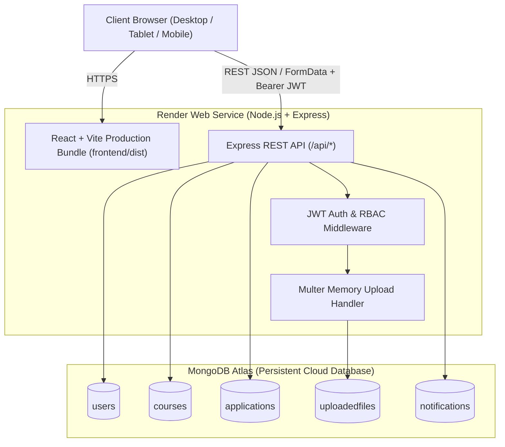
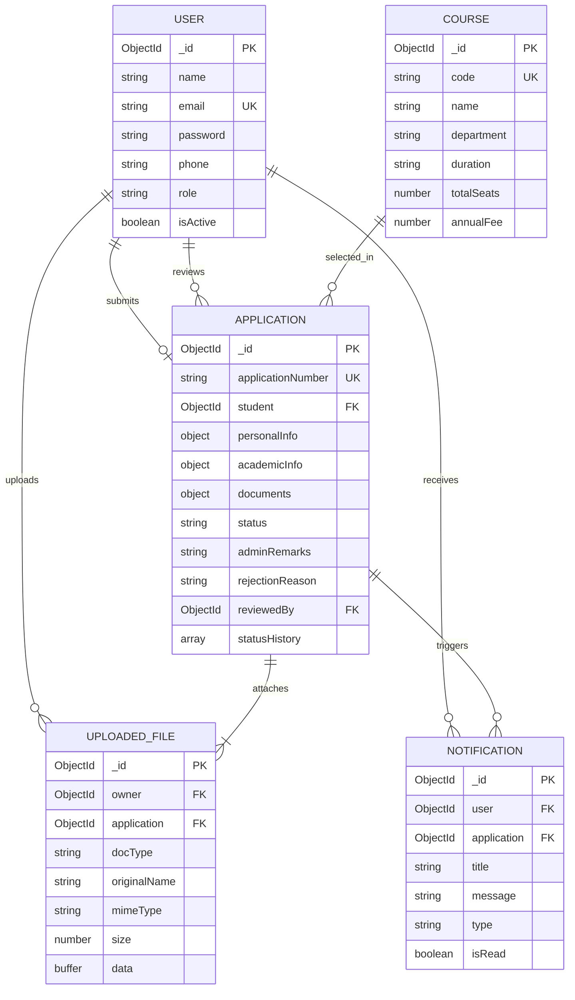
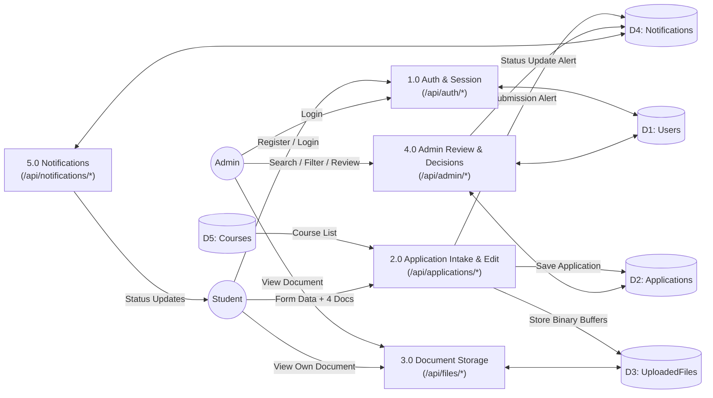
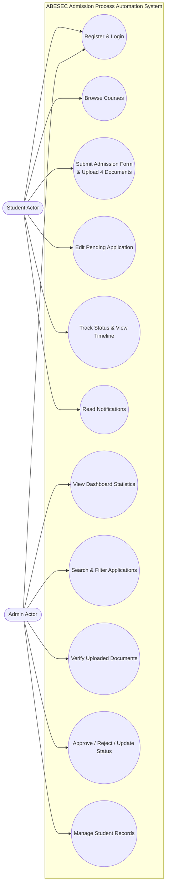

# Full Stack Development (FSD) System Design Document
## Project: Admission Process Automation System — ABESEC Ghaziabad

**Team Details:**
- **Team Leader:** Aryan Gupta (University Roll No: `2400320100289`)
- **Team Member 2:** Aryan Tyagi (University Roll No: `2400320100295`)
- **Branch & Section:** CSE — Section CSE-15
- **Academic Details:** B.Tech, 5th Semester, Batch 2024–28, Subject: Full Stack Development (FSD)
- **GitHub Repository:** https://github.com/aryangupta2940/Admission-Process-Automation

---

## 1. Project Introduction
The **Admission Process Automation System** is a full-stack MERN (MongoDB, Express.js, React.js, Node.js) web application built for **ABESEC Ghaziabad**. It digitizes the end-to-end college admission workflow, enabling prospective students to register online, fill out structured admission applications, upload verification documents, track status transitions in real time, and receive portal notifications. Simultaneously, it provides Admissions Administrators with a secure, role-protected dashboard to search, filter, inspect documents, approve, or reject applications with documented reasons.

---

## 2. Problem Statement
Traditional college admission workflows depend heavily on physical paper forms, manual spreadsheet tracking, in-person document submission, and repetitive phone or notice-board status inquiries. This leads to:
- Slow application turnaround times and administrative bottlenecks.
- Risk of misplaced physical marksheets or incomplete records.
- Lack of real-time visibility for applicants regarding verification progress.
- Difficulty searching, filtering, and auditing historical admission decisions.

---

## 3. Objectives
- **Digitize Admission Intake:** Replace paper-based forms with a validated online portal.
- **Centralized Persistent Storage:** Store applicant profiles, academic scores, uploaded documents, status history, and notifications in MongoDB.
- **Real-Time Transparency:** Provide live status tracking (`Pending`, `Under Review`, `Approved`, `Rejected`) and automated portal notifications.
- **Administrative Efficiency:** Equip staff with instant search (by Name, Email, or Application ID), status filters, inline document preview, and audit-logged decisions.
- **Role-Based Security:** Strictly isolate Student and Admin routes using JWT authentication and role-based middleware.

---

## 4. Scope of the Project
The system covers:
1. **Public Portal:** Institutional overview of ABESEC Ghaziabad admissions, dynamic course catalog, student registration, and unified login.
2. **Student Panel:** Personal dashboard, admission form creation & conditional editing (permitted while status is `Pending`), 4-document upload (Photograph, 10th Marksheet, 12th Marksheet, Identity Proof), application detail view with status timeline, and notification center.
3. **Admin Panel:** Real-time statistics dashboard, searchable/filterable application management table, full application & document review page, approval/rejection workflow with mandatory rejection reason, and student account management.
4. **Cloud Deployment:** Single-service Node/Express + Vite static bundle deployment on Render backed by MongoDB Atlas.

---

## 5. Functional Requirements

### 5.1 Student Module
- Register a new student account (`POST /api/auth/register`).
- Log in and log out securely (`POST /api/auth/login`, `POST /api/auth/logout`).
- View Student Dashboard with application summary, 4-step progress tracker, and recent notifications.
- Submit online admission form (`POST /api/applications`) containing:
  - Personal Info: Full Name, Email, Phone, Date of Birth, Gender, Residential Address, City, State, Pincode.
  - Academic Info: 10th Percentage, 12th Percentage, Previous School/College, Selected Course.
  - Documents: Photograph, 10th Marksheet, 12th Marksheet, Identity Proof (max 2 MB each).
- Edit application details (`PUT /api/applications/me`) only while status remains `Pending`.
- View full submitted application, secure document previews, admin remarks, and status history (`GET /api/applications/me`).
- Receive and mark admission notifications as read (`GET /api/notifications`, `PATCH /api/notifications/:id/read`, `PATCH /api/notifications/read-all`).

### 5.2 Admin Module
- Secure admin login (`POST /api/auth/login` with `role: 'admin'`).
- View Admin Dashboard (`GET /api/admin/stats`) showing Total Registered Students, Total Applications, Pending, Under Review, Approved, Rejected, course-wise breakdown, and recent submissions.
- Search applications by Student Name, Email, or Application ID (`ABES-YYYY-XXXX`), and filter by status (`GET /api/admin/applications`).
- Open individual application details (`GET /api/admin/applications/:id`) and view/download uploaded documents (`GET /api/files/:id`).
- Update application status (`PATCH /api/admin/applications/:id/status`) to `Pending`, `Under Review`, `Approved`, or `Rejected` (enforcing a mandatory `rejectionReason` when rejecting) and automatically generate student notifications.
- Manage student records (`GET /api/admin/students`, `PATCH /api/admin/students/:id/toggle-active`, `DELETE /api/admin/students/:id`).

---

## 6. Non-Functional Requirements
- **Security:** Passwords hashed via `bcryptjs` (10 salt rounds); stateless JWT authentication; `helmet` HTTP security headers; rate limiting on `/api/auth/*`; strict CORS origin checking; protected file access verifying ownership or admin role.
- **Reliability & Persistence:** All user records, applications, notifications, and uploaded binary documents are persisted in MongoDB (`UploadedFile` collection), avoiding ephemeral filesystem data loss on cloud restarts.
- **Usability & Responsiveness:** Clean Tailwind CSS dashboard layout adapting seamlessly across mobile, tablet, and desktop viewports with clear loading spinners, validation messages, and status badges.
- **Maintainability:** Modular MVC-style Express separation (`models/`, `routes/`, `middleware/`, `utils/`, `config/`) and reusable React components.

---

## 7. User Roles
| Role | Access Scope | Restricted From |
|---|---|---|
| **Guest (Unauthenticated)** | Home page, Course catalog (`GET /api/courses`), Login, Student Register | Student & Admin dashboards, Applications, File downloads |
| **Student (`role: 'student'`)** | Student Dashboard, Submit/Edit own Pending application, View own uploaded documents, Notifications | All `/api/admin/*` routes, other students' applications and files |
| **Admin (`role: 'admin'`)** | Admin Dashboard, View/Search/Filter all applications, View all documents, Approve/Reject/Update status, Manage student records | Public self-registration as admin (blocked by server) |

---

## 8. System Architecture
The application follows a decoupled 3-tier client-server architecture packaged for seamless single-origin deployment on Render:

---

## 9. Frontend Architecture
Built with **React 18**, **Vite**, **React Router v6**, **Tailwind CSS**, and **Lucide React**:
- `src/api/client.js`: Centralized Axios instance configuring `baseURL` (`VITE_API_URL/api` or `/api`), automatically injecting the `Authorization: Bearer <token>` header.
- `src/context/AuthContext.jsx`: Manages authentication state, session verification via `/api/auth/me`, login, registration, and logout.
- `src/components/ProtectedRoute.jsx`: Guards routes by authentication and role (`student` vs `admin`).
- `src/components/CollegeHeader.jsx` & `src/components/Footer.jsx`: Enforces the mandatory **ABESEC Ghaziabad** institutional header and **Aryan Gupta, Aryan Tyagi, CSE-15** footer across all pages.
- `src/components/SecureFilePreview.jsx`: Fetches protected documents as authenticated `Blob` objects via Axios and renders inline image/PDF modals or file downloads.

---

## 10. Backend Architecture
Built with **Node.js** and **Express.js**:
- `server.js`: Loads environment variables, connects to MongoDB (`config/db.js`), runs idempotent seeding (`utils/seedData.js`) when `AUTO_SEED` is enabled, and starts the HTTP server.
- `app.js`: Configures `helmet`, `cors`, `morgan`, rate limiting, `/api/health`, API route mounting, production static frontend serving, and centralized `errorHandler`.
- `middleware/auth.js`: `protect` verifies JWT tokens and active user status; `authorize(...roles)` enforces RBAC.
- `middleware/upload.js`: `multer.memoryStorage()` enforcing 2 MB size limits and strict MIME filtering (`image/jpeg`, `image/png`, `image/webp`, `application/pdf`).

---

## 11. Database Design
MongoDB collections managed via Mongoose schemas:
1. **User (`users`)**: `_id`, `name`, `email` (unique), `password` (bcrypt hash, `select: false`), `phone`, `role` (`student` | `admin`), `isActive`, `createdAt`, `updatedAt`.
2. **Course (`courses`)**: `_id`, `code` (unique), `name`, `department`, `duration`, `eligibility`, `totalSeats`, `annualFee`, `isActive`.
3. **Application (`applications`)**: `_id`, `applicationNumber` (unique `ABES-YYYY-XXXX`), `student` (unique ref `User`), `personalInfo` (embedded object), `academicInfo` (embedded object), `documents` (4 `documentMetaSchema` references to `UploadedFile`), `status` (`Pending` | `Under Review` | `Approved` | `Rejected`), `adminRemarks`, `rejectionReason`, `reviewedBy` (ref `User`), `reviewedAt`, `submittedAt`, `statusHistory` (audit array).
4. **UploadedFile (`uploadedfiles`)**: `_id`, `owner` (ref `User`), `application` (ref `Application`), `docType`, `originalName`, `mimeType`, `size`, `data` (`Buffer`).
5. **Notification (`notifications`)**: `_id`, `user` (ref `User`), `application` (ref `Application`), `title`, `message`, `type`, `isRead`, `createdAt`.

---

## 12. ER Diagram

---

## 13. Data Flow Diagram (DFD)

---

## 14. Use Case Diagram

---

## 15. API Design

| Method | Endpoint | Auth / Role | Description |
|---|---|---|---|
| `GET` | `/api/health` | Public | Health check & MongoDB connection state |
| `POST` | `/api/auth/register` | Public | Register a new student account |
| `POST` | `/api/auth/login` | Public | Authenticate student or admin and issue JWT |
| `GET` | `/api/auth/me` | Protected | Fetch currently authenticated user |
| `POST` | `/api/auth/logout` | Protected | Stateless logout acknowledgement |
| `GET` | `/api/courses` | Public | Fetch active ABESEC admission courses |
| `GET` | `/api/applications/me` | Student | Get logged-in student's application |
| `POST` | `/api/applications` | Student | Submit admission form + 4 documents (`multipart/form-data`) |
| `PUT` | `/api/applications/me` | Student | Edit application details/docs while status is `Pending` |
| `GET` | `/api/files/:id` | Owner or Admin | Stream uploaded document from MongoDB |
| `GET` | `/api/notifications` | Protected | List user notifications & unread count |
| `PATCH` | `/api/notifications/read-all` | Protected | Mark all notifications as read |
| `PATCH` | `/api/notifications/:id/read` | Protected | Mark specific notification as read |
| `GET` | `/api/admin/stats` | Admin | Dashboard metrics, course breakdown, recent apps |
| `GET` | `/api/admin/applications` | Admin | Search & filter applications (`search`, `status`, `course`) |
| `GET` | `/api/admin/applications/:id` | Admin | View full application details |
| `PATCH` | `/api/admin/applications/:id/status` | Admin | Update status (`Under Review`, `Approved`, `Rejected`, `Pending`) |
| `GET` | `/api/admin/students` | Admin | List registered students & application status |
| `PATCH` | `/api/admin/students/:id/toggle-active` | Admin | Activate/deactivate student account |
| `DELETE` | `/api/admin/students/:id` | Admin | Remove student record and linked data |

---

## 16. Authentication and Authorization
1. **Password Security:** Passwords are never stored in plaintext. `User` schema's pre-save hook hashes passwords using `bcryptjs` with 10 salt rounds.
2. **JWT Issuance:** Successful login/registration returns a signed JWT (`id`, `role`) valid for `JWT_EXPIRES_IN` (default `7d`).
3. **Route Protection:** `protect` extracts the `Bearer` token, verifies signature via `JWT_SECRET`, checks user existence & `isActive` flag, and attaches `req.user`.
4. **Role Enforcement:** `authorize('admin')` rejects any non-admin request with HTTP `403 Forbidden`. Public `/api/auth/register` hardcodes `role: 'student'`.
5. **Document Isolation:** `/api/files/:id` verifies that `req.user.role === 'admin'` OR `file.owner === req.user._id` before streaming binary data.

---

## 17. Deployment Architecture
- **Hosting Platform:** Render Web Service (`render.yaml` Blueprint).
- **Build Command:** `npm run build` (installs backend + frontend dependencies and builds `frontend/dist`).
- **Start Command:** `npm start` (runs `backend/server.js`, serving both `/api/*` and the compiled React SPA).
- **Database:** MongoDB Atlas M0 persistent cloud cluster connected via `MONGO_URI`.
- **Environment Variables:** `NODE_ENV`, `MONGO_URI`, `JWT_SECRET`, `JWT_EXPIRES_IN`, `CORS_ORIGIN`, `SERVE_FRONTEND`, `AUTO_SEED`.

---

## 18. Testing Strategy
- **Automated Backend Integration Tests (`backend/tests/api.test.js`):** Uses Node.js test runner (`node --test`), `supertest`, and `mongodb-memory-server` to verify:
  - Idempotent seeding (`ensureSeedData`).
  - Student registration, duplicate email rejection, and RBAC enforcement (`403` for student accessing admin APIs).
  - Multipart application submission with 4 binary attachments & unique `ABES-YYYY-XXXX` generation.
  - Edit-while-Pending and edit-locking after `Under Review`.
  - Document isolation (`403` when another student accesses a file, `200` for owner and admin).
  - Admin search/filter, rejection reason validation (`400` if empty), approval, notifications, and dashboard stats.
- **Frontend Production Build:** Verified via `vite build` with zero bundler or JSX errors.
- **End-to-End Live Verification:** Interactive API + UI verification covering registration, login, form submission, upload preview, approval/rejection, and status visibility.

---

## 19. Future Enhancements
- Online admission fee payment gateway (Razorpay / Stripe) integrated with fee receipt generation.
- Automated email and SMS alerts (Nodemailer / Twilio) alongside in-portal notifications.
- Downloadable PDF admission offer letter and fee receipt upon approval.
- OCR-assisted verification for 10th and 12th marksheets.
- Multi-campus / department-level reviewer roles and merit list generation.
